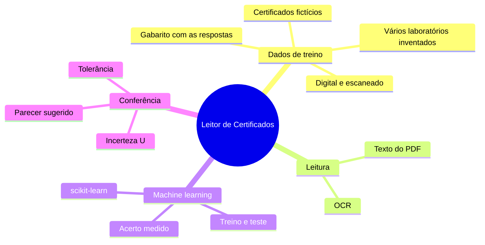
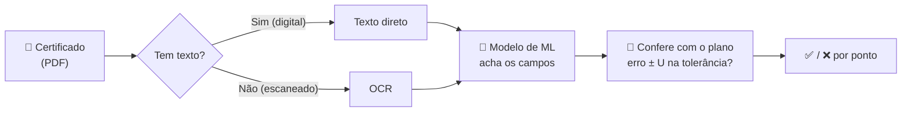

# Leitor de Certificados com IA

  
  
  
  
  

  
  
  

  
  
  
  
  
  

  Projeto de estudo de <b>machine learning</b>: um modelo que lê <b>certificados de calibração em
  PDF</b> — digitais ou escaneados —, encontra os dados importantes e confere se o instrumento está
  dentro da tolerância do plano de calibração, considerando a incerteza de medição.

  <a href="#-visão-geral">Visão Geral</a> •
  <a href="#-como-vai-funcionar">Como vai funcionar</a> •
  <a href="#-dados-fictícios">Dados fictícios</a> •
  <a href="#️-tecnologias">Tecnologias</a> •
  <a href="#️-roteiro">Roteiro</a>

---

## 📌 Visão Geral

Este projeto nasceu do [**Sistema de Gestão de Calibração**](https://github.com/jcesarmph-ui/SistemaCalibracao),
um aplicativo desktop em uso numa empresa. Lá, cada calibração é digitada à mão a partir do
certificado do laboratório. A pergunta deste projeto é: **dá para uma IA gratuita, rodando no
próprio computador, ler o certificado e conferir sozinha?**

É um projeto para **aprender e mostrar o aprendizado**: cada etapa mede o acerto do modelo e
registra o que melhorou — mesmo quando ele erra.

| ❌ Problema | 💡 Solução | ✅ Resultado esperado |
|---|---|---|
| Digitar cada ponto do certificado é demorado e sujeito a erro. | Modelo de **machine learning** que encontra nº do certificado, data, laboratório e os pontos medidos. | Dados extraídos automaticamente, com o **acerto medido**. |
| Certificados chegam em PDF digital **e** escaneado. | Dois caminhos: texto direto do PDF e **OCR** (ler a imagem). | Comparar o acerto de cada tipo. |
| Conferir a conformidade exige considerar a incerteza (U). | Regra de avaliação: `erro ± U` dentro da tolerância. | Parecer sugerido ponto a ponto. |
| IA paga e envio de documentos para a nuvem. | **scikit-learn** e OCR **locais e gratuitos**. | Nenhum dado sai do computador, custo zero. |

## 🧠 Como vai funcionar

Um modelo de machine learning **aprende com exemplos que têm resposta**. Por isso o projeto começa
gerando certificados fictícios junto com o **gabarito** (o que o modelo deveria encontrar). Parte
deles serve para **treinar**; a outra parte, que o modelo nunca viu, serve para **testar** e medir
o acerto de verdade.

## 🔒 Dados fictícios

> [!IMPORTANT]
> Este repositório é público e **não contém nenhum certificado real**. Todos os certificados,
> laboratórios, instrumentos, números e pessoas que aparecem aqui são **inventados** pelo próprio
> projeto. Testes com certificados reais acontecem só no computador do autor, e aqui aparecem apenas
> os **números de acerto**.

## 🛠️ Tecnologias

| Tecnologia | Aplicação no projeto |
|---|---|
| Python | Linguagem de todo o projeto. |
| scikit-learn | Modelo de machine learning (gratuito, roda no computador). |
| OCR local | Leitura dos certificados escaneados (definido na etapa de leitura). |
| pytest + ruff | Testes automáticos com certificados fictícios e padronização do código. |
| Git + GitHub | Uma branch e um pull request por etapa; decisões registradas em ADRs. |
| Claude Code | Desenvolvimento assistido por IA, com o autor definindo e aprovando cada etapa. |

Decisões de arquitetura: [`docs/decisoes/`](docs/decisoes/).

## 🗺️ Roteiro

- [x] Etapa 0 — Fundação (estrutura, versão, testes, decisões de arquitetura)
- [ ] Etapa 1 — Gerador de certificados fictícios (digital e "escaneado") com gabarito
- [ ] Etapa 2 — Leitura do PDF: texto direto e OCR
- [ ] Etapa 3 — Machine learning: encontrar os campos; acerto medido em treino × teste
- [ ] Etapa 4 — Conferência com o plano: erro ± U dentro da tolerância
- [ ] Etapa 5 — Teste com certificados reais (só os números de acerto aparecem aqui)

---

  <b>Projeto de estudo de machine learning aplicado à metrologia: aprender, medir o acerto e mostrar
  a evolução — com dados 100% fictícios.</b>

