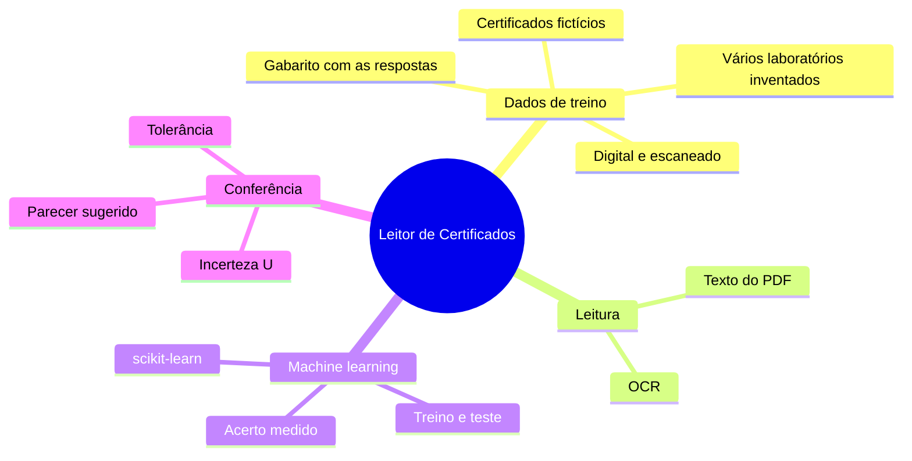
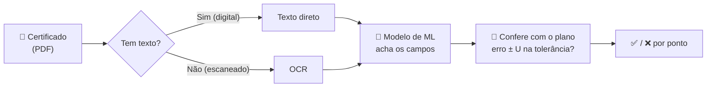
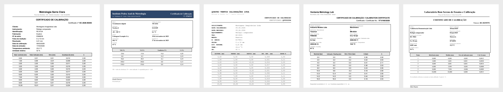
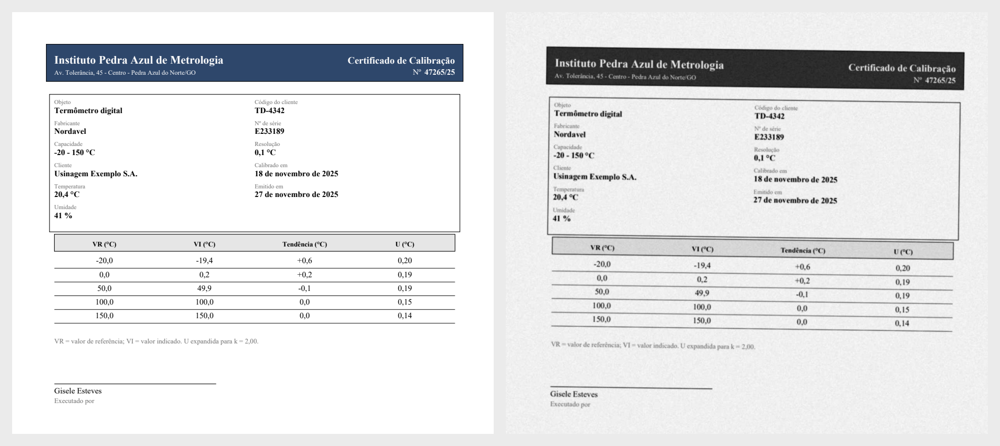
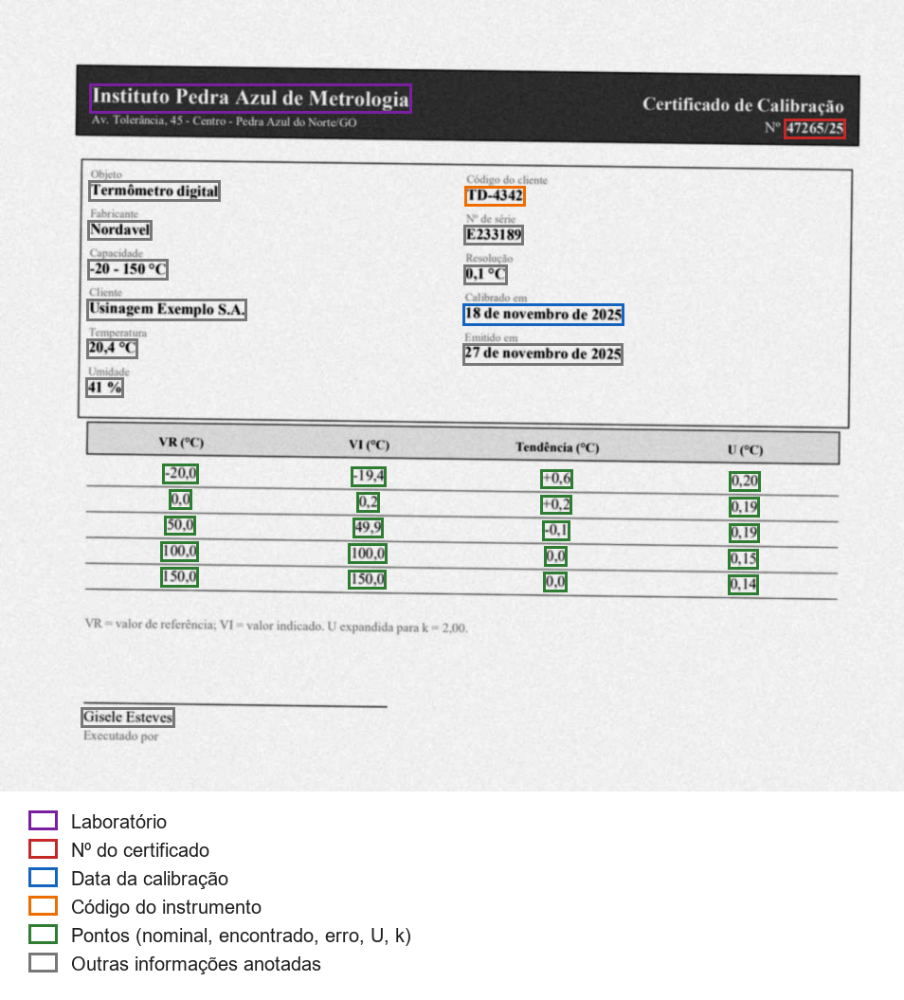
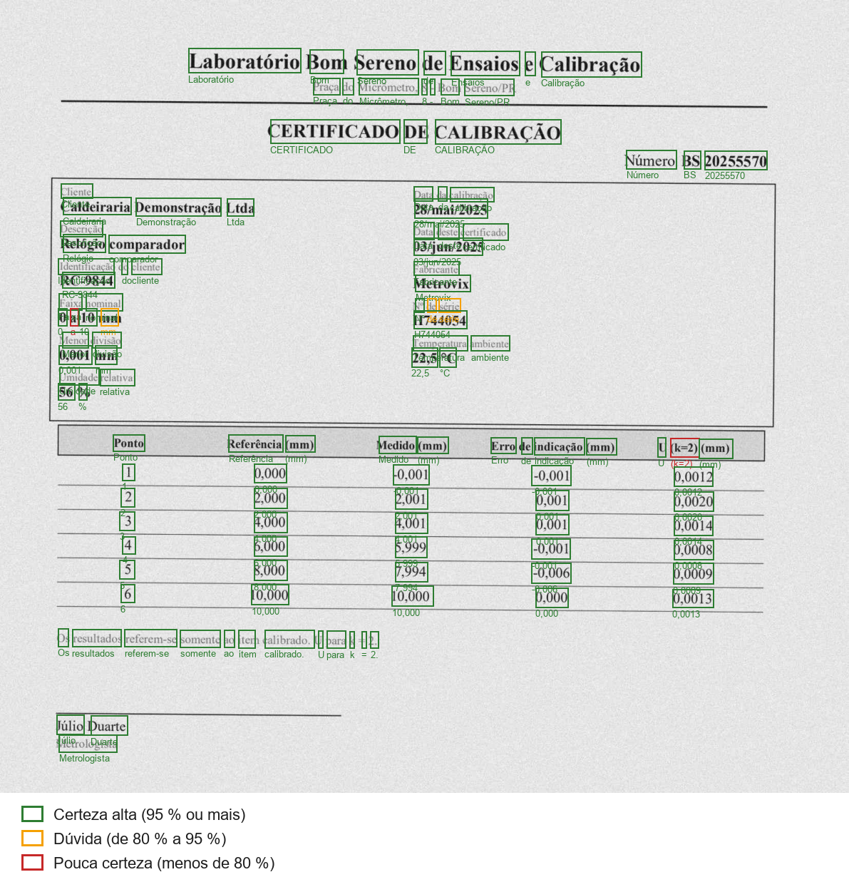

# Leitor de Certificados com IA

  
  
  
  
  

  
  
  

  
  
  
  
  
  

  Projeto de estudo de <b>machine learning</b>: um modelo que lê <b>certificados de calibração em
  PDF</b> — digitais ou escaneados —, encontra os dados importantes e confere se o instrumento está
  dentro da tolerância do plano de calibração, considerando a incerteza de medição.

  <a href="#-visão-geral">Visão Geral</a> •
  <a href="#-como-vai-funcionar">Como vai funcionar</a> •
  <a href="#-dados-fictícios">Dados fictícios</a> •
  <a href="#-certificados-fictícios">Certificados fictícios</a> •
  <a href="#-leitura-do-pdf">Leitura do PDF</a> •
  <a href="#️-tecnologias">Tecnologias</a> •
  <a href="#️-roteiro">Roteiro</a>

---

## 📌 Visão Geral

Este projeto nasceu do [**Sistema de Gestão de Calibração**](https://github.com/jcesarmph-ui/SistemaCalibracao),
um aplicativo desktop em uso numa empresa. Lá, cada calibração é digitada à mão a partir do
certificado do laboratório. A pergunta deste projeto é: **dá para uma IA gratuita, rodando no
próprio computador, ler o certificado e conferir sozinha?**

É um projeto para **aprender e mostrar o aprendizado**: cada etapa mede o acerto do modelo e
registra o que melhorou — mesmo quando ele erra.

| ❌ Problema | 💡 Solução | ✅ Resultado esperado |
|---|---|---|
| Digitar cada ponto do certificado é demorado e sujeito a erro. | Modelo de **machine learning** que encontra nº do certificado, data, laboratório e os pontos medidos. | Dados extraídos automaticamente, com o **acerto medido**. |
| Certificados chegam em PDF digital **e** escaneado. | Dois caminhos: texto direto do PDF e **OCR** (ler a imagem). | Comparar o acerto de cada tipo. |
| Conferir a conformidade exige considerar a incerteza (U). | Regra de avaliação: `erro ± U` dentro da tolerância. | Parecer sugerido ponto a ponto. |
| IA paga e envio de documentos para a nuvem. | **scikit-learn** e OCR **locais e gratuitos**. | Nenhum dado sai do computador, custo zero. |

## 🧠 Como vai funcionar

Um modelo de machine learning **aprende com exemplos que têm resposta**. Por isso o projeto começa
gerando certificados fictícios junto com o **gabarito** (o que o modelo deveria encontrar). Parte
deles serve para **treinar**; a outra parte, que o modelo nunca viu, serve para **testar** e medir
o acerto de verdade.

## 🔒 Dados fictícios

> [!IMPORTANT]
> Este repositório é público e **não contém nenhum certificado real**. Todos os certificados,
> laboratórios, instrumentos, números e pessoas que aparecem aqui são **inventados** pelo próprio
> projeto. Testes com certificados reais acontecem só no computador do autor, e aqui aparecem apenas
> os **números de acerto**.

## 🧾 Certificados fictícios

O primeiro passo foi construir um **gerador de certificados inventados**: o modelo só aprende com
exemplos que têm a resposta certa, e certificados reais não podem aparecer aqui. Cada certificado
gerado sai em **três arquivos**: o PDF **digital**, o mesmo certificado **"escaneado"** e o
**gabarito**.

**Cinco laboratórios inventados**, cada um com o seu jeito de montar a folha — para o modelo
aprender o que cada informação **é**, e não decorar onde ela fica:

  

| O que muda de um laboratório para outro | Exemplos |
|---|---|
| Nome das informações | "Data da calibração", "Calibrado em", "DATA CALIBRACAO", "Calibration date" |
| Nome e ordem das colunas | "Valor indicado", "VI", "LEITURA", "Medido" — e a leitura às vezes vem antes do padrão |
| Formato da data | 09/03/2026 · 9 de março de 2026 · 09.03.2026 · 2026-03-09 · 09/mar/2026 |
| Números | vírgula ou ponto decimal; erro com ou sem "+"; fator k na tabela ou só na observação |
| Aparência | três fontes, três cabeçalhos, informações em lista ou em quadro, posição levemente sorteada |

**Digital × escaneado.** Muitos certificados chegam escaneados: são só uma foto da folha, sem
texto dentro do PDF. O gerador imita um scanner — folha um pouco torta, ruído do papel, desfoque e
compressão JPEG — para treinar e medir também a leitura por OCR:

  

**O gabarito.** Para cada informação importante, o gabarito guarda **o valor certo e a caixa
onde ele está na folha** — também na versão torta. É com isso que o modelo vai ser ensinado e
corrigido:

  

<b>Como o gerador garante que o gabarito está certo</b>

- Testes automáticos abrem cada PDF digital e conferem que o texto **dentro de cada caixa** é
  exatamente a resposta anotada.
- No escaneado, conferem que o PDF **não tem texto nenhum** (só imagem) e que dentro das caixas
  giradas há tinta — ou seja, elas acompanharam o giro da folha.
- Pontos coerentes: erro = encontrado − nominal; o primeiro e o último ponto são o começo e o fim
  da faixa; os do meio são valores "redondos", como num certificado de verdade.
- Cada certificado tem a sua **semente**: gerar de novo produz exatamente o mesmo arquivo, para
  repetir treinos e comparar resultados de forma justa.
- Exemplos prontos (um de cada laboratório) em [`exemplos/`](exemplos/).

## 👁️ Leitura do PDF

A segunda etapa transforma qualquer PDF numa **lista de palavras com posição** (a mesma medida do
gabarito), igual nos dois casos — assim o machine learning da próxima etapa não precisa saber de
onde a palavra veio. O programa escolhe o caminho **página por página**:

| Caminho | Como lê | Acerto* | Tempo por certificado |
|---|---|---|---|
| 📄 **Digital** | Texto e posição direto de dentro do PDF | **100 %** (1525 de 1525) | 0,01 s |
| 🖼️ **Escaneado** | **OCR** local (RapidOCR): acha as linhas na imagem e lê as letras | **98,1 %** (1496 de 1525) | cerca de 5 s |

*Respostas do gabarito lidas sem nenhum erro, em 30 certificados fictícios.

No OCR cada palavra guarda a **confiança** (verde = certeza alta, amarelo = dúvida, vermelho = pouca
certeza). Os erros que sobram são quase todos números pequenos da tabela (a vírgula lida como
apóstrofo) e o nome do laboratório grudado no endereço:

  

> [!NOTE]
> Os fictícios são mais limpos que os escaneados de verdade: num teste com um escaneado real, a
> confiança média do OCR ficou bem abaixo da dos fictícios. Por isso o gerador imita um scanner
> mais ruim (150 dpi, mais ruído) e a etapa 5 vai mostrar o acerto real, sem esconder a diferença.

## 🛠️ Tecnologias

| Tecnologia | Aplicação no projeto |
|---|---|
| Python | Linguagem de todo o projeto. |
| scikit-learn | Modelo de machine learning (gratuito, roda no computador). |
| reportlab | Escreve os PDFs digitais dos certificados fictícios. |
| pypdfium2 | Transforma o PDF em imagem (para o "escaneado") e lê o texto do PDF. |
| Pillow | Imita o scanner: giro, ruído, desfoque e compressão JPEG. |
| RapidOCR (ONNX) | OCR local e gratuito: lê os certificados escaneados, palavra por palavra, com a confiança de cada uma. |
| pytest + ruff | Testes automáticos com certificados fictícios e padronização do código. |
| Git + GitHub | Uma branch e um pull request por etapa; decisões registradas em ADRs. |
| Claude Code | Desenvolvimento assistido por IA, com o autor definindo e aprovando cada etapa. |

Decisões de arquitetura: [`docs/decisoes/`](docs/decisoes/).

## 🗺️ Roteiro

- [x] Etapa 0 — Fundação (estrutura, versão, testes, decisões de arquitetura)
- [x] Etapa 1 — Gerador de certificados fictícios (5 laboratórios, digital e "escaneado") com gabarito anotado
- [x] Etapa 2 — Leitura do PDF: texto direto e OCR (palavras com posição e confiança)
- [ ] Etapa 3 — Machine learning: encontrar os campos; acerto medido em treino × teste
- [ ] Etapa 4 — Conferência com o plano: erro ± U dentro da tolerância
- [ ] Etapa 5 — Teste com certificados reais (só os números de acerto aparecem aqui)

---

  <b>Projeto de estudo de machine learning aplicado à metrologia: aprender, medir o acerto e mostrar
  a evolução — com dados 100% fictícios.</b>

