# Leitor de Certificados com IA

  
  
  
  
  
  

  
  
  

  
  
  
  
  
  

  Projeto de estudo de <b>machine learning</b>: um modelo que lê <b>certificados de calibração em
  PDF</b> — digitais ou escaneados —, encontra os dados importantes e confere se o instrumento está
  dentro da tolerância do plano de calibração, considerando a incerteza de medição.

  <a href="#-visão-geral">Visão Geral</a> •
  <a href="#-telas">Telas</a> •
  <a href="#-como-vai-funcionar">Como vai funcionar</a> •
  <a href="#-dados-fictícios">Dados fictícios</a> •
  <a href="#-certificados-fictícios">Certificados fictícios</a> •
  <a href="#-leitura-do-pdf">Leitura do PDF</a> •
  <a href="#-machine-learning">Machine learning</a> •
  <a href="#-conferência-com-o-plano">Conferência</a> •
  <a href="#-validade-dos-padrões">Padrões</a> •
  <a href="#-aprendizado-com-o-uso">Aprendizado com o uso</a> •
  <a href="#️-tecnologias">Tecnologias</a> •
  <a href="#️-roteiro">Roteiro</a>

---

## 📌 Visão Geral

Este projeto nasceu do [**Sistema de Gestão de Calibração**](https://github.com/jcesarmph-ui/SistemaCalibracao),
um aplicativo desktop em uso corporativo. Lá, cada calibração é digitada à mão a partir do
certificado do laboratório. A pergunta deste projeto é: **dá para uma IA gratuita, rodando no
próprio computador, ler o certificado e conferir sozinha?**

É um projeto para **aprender e mostrar o aprendizado**: cada etapa mede o acerto do modelo e
registra o que melhorou — mesmo quando ele erra.

| ❌ Problema | 💡 Solução | ✅ Resultado esperado |
|---|---|---|
| Digitar cada ponto do certificado é demorado e sujeito a erro. | Modelo de **machine learning** que encontra nº do certificado, data, laboratório e os pontos medidos. | Dados extraídos automaticamente, com o **acerto medido**. |
| Certificados chegam em PDF digital **e** escaneado. | Dois caminhos: texto direto do PDF e **OCR** (ler a imagem). | Comparar o acerto de cada tipo. |
| Conferir a conformidade exige considerar a incerteza (U). | Regra de avaliação: `erro ± U` dentro da tolerância. | Parecer sugerido ponto a ponto. |
| Um padrão do laboratório vencido invalida a calibração, e isso passa despercebido. | O modelo lê a tabela de **padrões** e a data da calibração. | Padrão vencido no dia da calibração deixa o parecer **pendente**. |
| IA paga e envio de documentos para a nuvem. | **scikit-learn** e OCR **locais e gratuitos**. | Nenhum dado sai do computador, custo zero. |

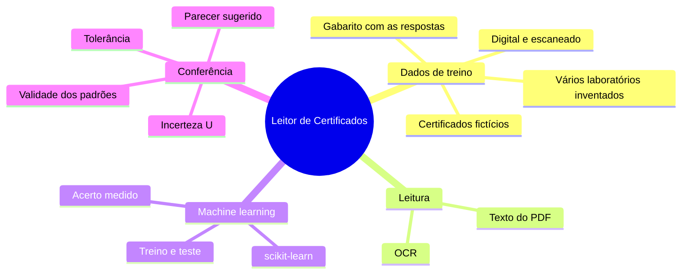

## 📸 Telas

> [!NOTE]
> Todas as fotos usam **certificados, planos e um modelo 100 % fictícios**, criados do zero só
> para as fotos. Nenhum dado real aparece aqui.

  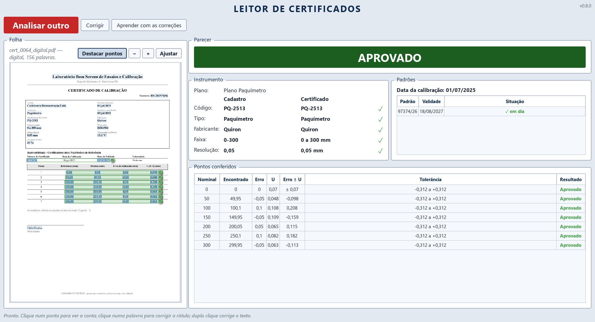
   <i>Certificado nunca visto pelo modelo: cada ponto da tabela ganha um check, e o painel mostra o código achado, a faixa (lida × plano) e a conta erro ± U × tolerância.</i>

| | |
|---|---|
| 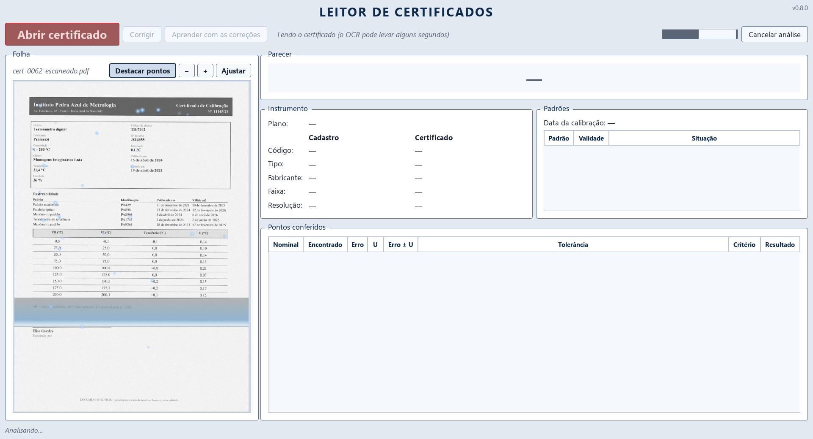 | 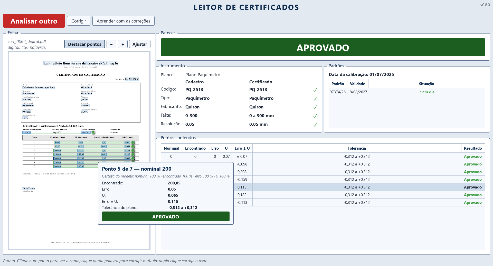 |
| *Analisando um escaneado: uma faixa de "raio X" percorre a folha enquanto o OCR lê; dá para cancelar.* | *Clique num ponto: a conta completa e a certeza do modelo em cada número.* |
| 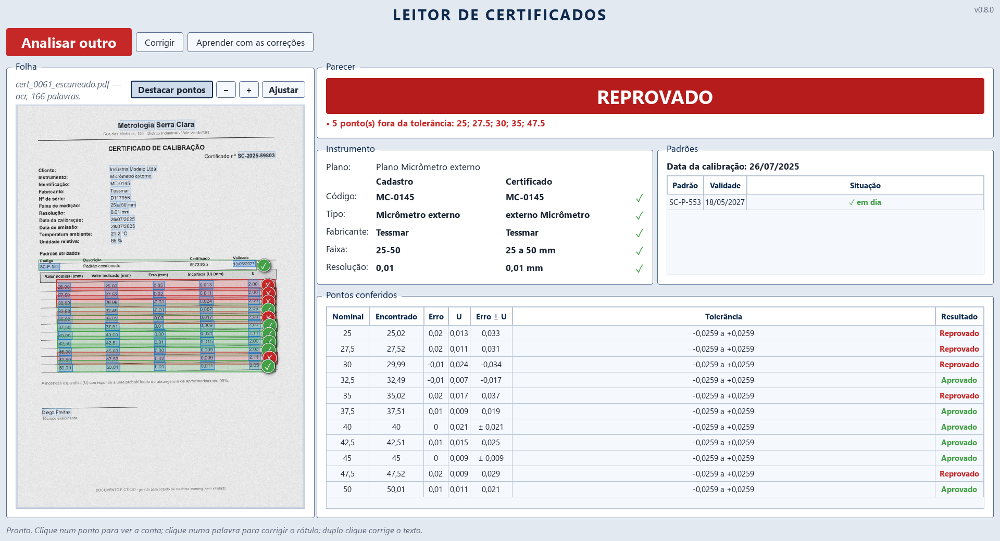 | 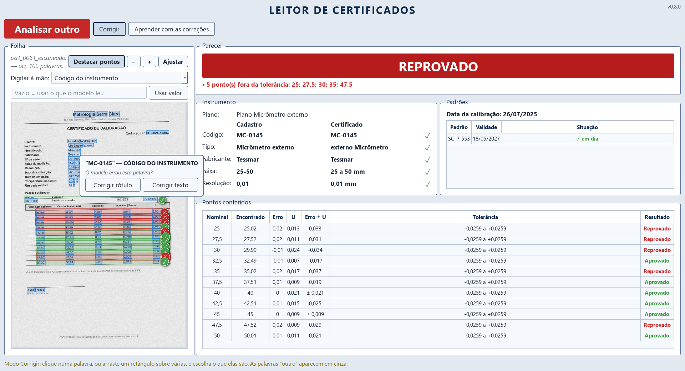 |
| *Escaneado com pontos fora da tolerância: ✗ vermelho na folha e na tabela.* | *Modo Corrigir: clicar numa palavra corrige o rótulo ou o texto; o que não dá para ler (ex.: código a caneta) pode ser digitado à mão.* |

  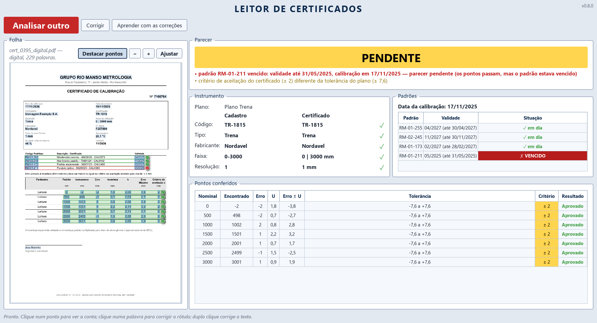
   <i>Versão 0.8.0: os pontos passam, mas um padrão estava vencido no dia da calibração — ✗ vermelho no padrão (folha e caixa "Padrões"), motivo em vermelho e parecer pendente.</i>

## 🧠 Como vai funcionar

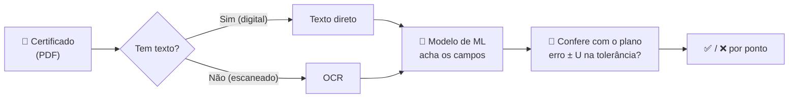

Um modelo de machine learning **aprende com exemplos que têm resposta**. Por isso o projeto começa
gerando certificados fictícios junto com o **gabarito** (o que o modelo deveria encontrar). Parte
deles serve para **treinar**; a outra parte, que o modelo nunca viu, serve para **testar** e medir
o acerto de verdade.

## 🔒 Dados fictícios

> [!IMPORTANT]
> Este repositório é público e **não contém nenhum certificado real**. Todos os certificados,
> laboratórios, instrumentos, números e pessoas que aparecem aqui são **inventados** pelo próprio
> projeto. Testes com certificados reais acontecem só no computador do autor, e aqui aparecem apenas
> os **números de acerto**.

## 🧾 Certificados fictícios

O primeiro passo foi construir um **gerador de certificados inventados**: o modelo só aprende com
exemplos que têm a resposta certa, e certificados reais não podem aparecer aqui. Cada certificado
gerado sai em **três arquivos**: o PDF **digital**, o mesmo certificado **"escaneado"** e o
**gabarito**.

**Cinco laboratórios inventados**, cada um com o seu jeito de montar a folha — para o modelo
aprender o que cada informação **é**, e não decorar onde ela fica (um **sexto**, com as colunas
"Erro Máximo" e "Critério de aceitação", entrou na versão 0.7.0):

  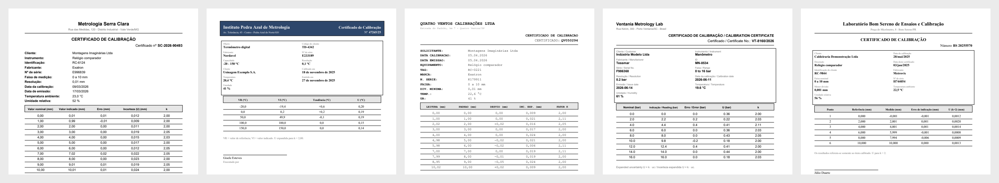

| O que muda de um laboratório para outro | Exemplos |
|---|---|
| Nome das informações | "Data da calibração", "Calibrado em", "DATA CALIBRACAO", "Calibration date" |
| Nome e ordem das colunas | "Valor indicado", "VI", "LEITURA", "Medido" — e a leitura às vezes vem antes do padrão |
| Formato da data | 09/03/2026 · 9 de março de 2026 · 09.03.2026 · 2026-03-09 · 09/mar/2026 |
| Números | vírgula ou ponto decimal; erro com ou sem "+"; fator k na tabela ou só na observação |
| Aparência | três fontes, três cabeçalhos, informações em lista ou em quadro, posição levemente sorteada |

**Digital × escaneado.** Muitos certificados chegam escaneados: são só uma foto da folha, sem
texto dentro do PDF. O gerador imita um scanner — folha um pouco torta, ruído do papel, desfoque e
compressão JPEG — para treinar e medir também a leitura por OCR:

  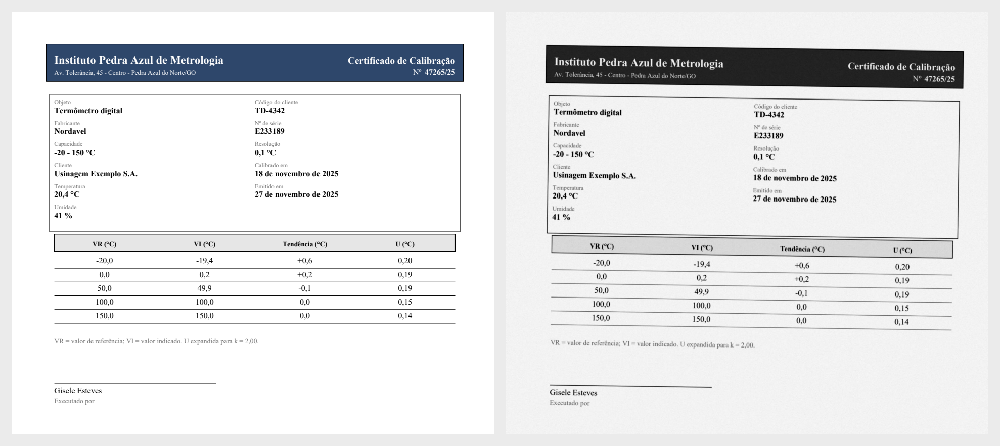

**O gabarito.** Para cada informação importante, o gabarito guarda **o valor certo e a caixa
onde ele está na folha** — também na versão torta. É com isso que o modelo vai ser ensinado e
corrigido:

  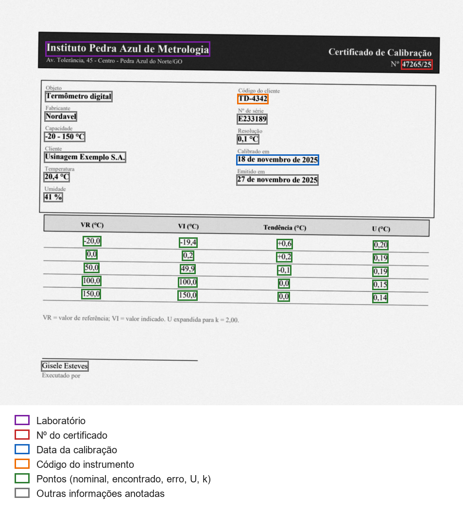

<b>Como o gerador garante que o gabarito está certo</b>

- Testes automáticos abrem cada PDF digital e conferem que o texto **dentro de cada caixa** é
  exatamente a resposta anotada.
- No escaneado, conferem que o PDF **não tem texto nenhum** (só imagem) e que dentro das caixas
  giradas há tinta — ou seja, elas acompanharam o giro da folha.
- Pontos coerentes: erro = encontrado − nominal; o primeiro e o último ponto são o começo e o fim
  da faixa; os do meio são valores "redondos", como num certificado de verdade.
- Cada certificado tem a sua **semente**: gerar de novo produz exatamente o mesmo arquivo, para
  repetir treinos e comparar resultados de forma justa.
- Exemplos prontos (um de cada laboratório) em [`exemplos/`](exemplos/).

## 👁️ Leitura do PDF

A segunda etapa transforma qualquer PDF numa **lista de palavras com posição** (a mesma medida do
gabarito), igual nos dois casos — assim o machine learning da próxima etapa não precisa saber de
onde a palavra veio. O programa escolhe o caminho **página por página**:

| Caminho | Como lê | Acerto* | Tempo por certificado |
|---|---|---|---|
| 📄 **Digital** | Texto e posição direto de dentro do PDF | **100 %** (1525 de 1525) | 0,01 s |
| 🖼️ **Escaneado** | **OCR** local (RapidOCR): acha as linhas na imagem e lê as letras | **98,1 %** (1496 de 1525) | cerca de 5 s |

*Respostas do gabarito lidas sem nenhum erro, em 30 certificados fictícios.

No OCR cada palavra guarda a **confiança** (verde = certeza alta, amarelo = dúvida, vermelho = pouca
certeza). Os erros que sobram são quase todos números pequenos da tabela (a vírgula lida como
apóstrofo) e o nome do laboratório grudado no endereço:

  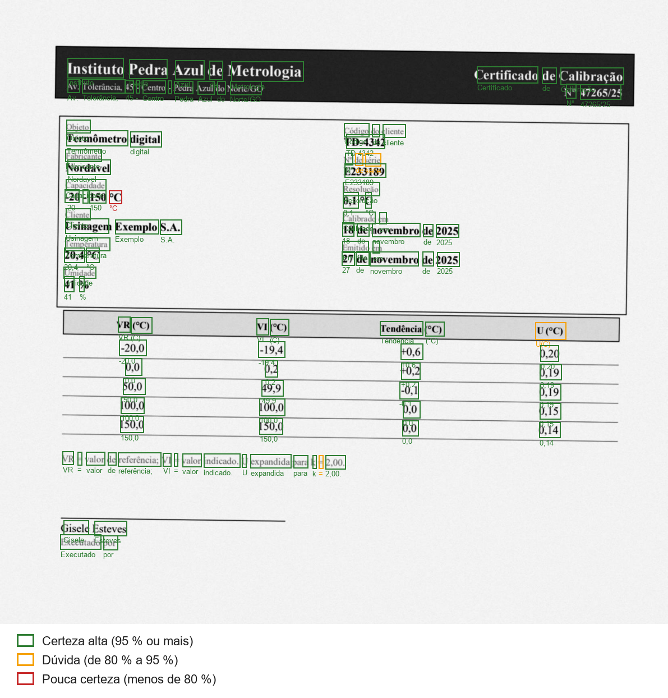

> [!NOTE]
> Os fictícios são mais limpos que os escaneados de verdade: num teste com um escaneado real, a
> confiança média do OCR ficou bem abaixo da dos fictícios. Por isso o gerador imita um scanner
> mais ruim (150 dpi, mais ruído) e a etapa 5 vai mostrar o acerto real, sem esconder a diferença.

## 🤖 Machine learning

O modelo recebe a lista de palavras da etapa anterior e aprende a dizer **o que cada palavra é**
(número do certificado, data, laboratório, valor de cada ponto…). Ele não enxerga a folha: recebe
**pistas** — como a palavra é escrita, o que há ao lado e em cima (o título da coluna) e o que os
números fazem na tabela (o *erro* é *encontrado − nominal*, o *nominal* cresce e é "redondo", o *k*
é o mesmo em todas as linhas). A posição na folha entra só como pista fraca, porque cada laboratório
monta a folha de um jeito.

**Como saber se aprendeu?** Medindo em certificados que o modelo **nunca viu** — e a diferença entre
as provas é o que mostra se ele entendeu ou decorou:

| Prova | Palavras certas | Campos inteiros certos |
|---|---|---|
| Certificados novos de laboratórios já vistos | 100 % | 100 % |
| 🔎 **Laboratório que o modelo nunca viu** (treina com 4, testa no 5º) | **80,4 %** | **73,2 %** |
| Escaneado lido por OCR (treino só com o digital) | 99,1 % | 98,1 % |

Média dos 5 laboratórios fictícios; 150 certificados. Campo inteiro certo = todas as palavras
da caixa do gabarito com o rótulo certo.

> [!NOTE]
> A prova que conta é a do laboratório novo. O primeiro modelo tirava 100 % nos laboratórios que já
> conhecia e só **76,7 %** das palavras (**54,2 %** dos campos) no laboratório novo: decorava mais do
> que entendia. As pistas numéricas e de pedaços de letras subiram esse número sem mexer no teste. O
> que ainda erra é estrutura que nenhum laboratório de treino tinha — a cura é **mais variedade**:
> cada tipo novo de certificado entra no treino e o modelo é medido de novo.

## ✅ Conferência com o plano

Com os campos lidos, o programa acha o instrumento no plano de calibração, calcula o **erro ± U** de
cada ponto e dá o parecer. A regra é a mesma do sistema de calibração; o plano é lido só para
consulta. **Na dúvida, o parecer fica "pendente"** — melhor pedir uma conferência do que errar.
A **faixa** lida também é comparada com a do cadastro (mínimo e máximo): se for diferente, ou se
não der para comparar, aparece um aviso amarelo — o parecer continua vindo da tolerância.

<b>Novidades da versão 0.7.0 na conferência</b>

- **Comparador cadastro × certificado** no painel Instrumento: código, tipo, fabricante, faixa e
  resolução lado a lado — check verde quando batem, "não bate" em amarelo quando não. **Só
  informa**: uma letra lida diferente nunca reprova um certificado.
- **Critério de aceitação ±** do laboratório comparado com a tolerância do plano: se for
  diferente, aviso amarelo (o laboratório julgou com outra régua) — o parecer não muda.
- **Erro ± U igual ao do sistema de calibração**: o lado mais perto da tolerância
  (erro −1 e U 1 → **−2**, e não 0); "± U" só quando o erro é zero.
- **Pontos repetidos no plano** (ex.: goniômetro com 0° e 90° em cada quadrante; válvula com três
  aberturas de 8 bar) casados na ordem com os do certificado.
- Quando o modelo marca **dois números da mesma linha com o mesmo rótulo**, vale o de maior
  certeza — e, para o nominal, o que existe no plano.

<b>Novidades da versão 0.9.0: conferência de conta e goniômetro</b>

- **O número só vale se fecha a conta**: o erro tem de bater com "encontrado − nominal" (em
  qualquer um dos dois sinais — há laboratório que escreve "Instrumento − Padrão") e, quando o
  certificado traz "Erro Máximo", |erro| + U tem de dar esse valor. Se não fecha nem trocando as
  colunas, o ponto fica **não avaliado** e o parecer **pendente**: o programa nunca aprova nem
  reprova com um número que não fecha. Isso corrigiu um goniômetro que saía **reprovado por
  engano** (o número do quadrante, 1-2-3-4, tinha entrado no lugar do erro).
- **Graus e minutos**: "14°59'" é lido como ângulo; a conta é feita em graus e a tela mostra igual
  ao certificado (90°00', erro 0°04').
- **Código com menos zeros** ("GON-02" × "GON-002") acha o instrumento; se houver dúvida entre
  dois, vale o único cujo plano tem **os mesmos pontos nominais** do certificado.
- O programa **treina de novo sozinho** quando o modelo salvo ficou para trás das correções.
- Muitos avisos ganham **rolagem própria** e não escondem mais a tabela de pontos.

<b>Novidades da versão 0.10.0: registro das análises</b>

- **Registrar**: cada análise pode ser guardada num registro (quem, em qual computador, quando,
  o que foi lido, o parecer e o que foi corrigido), aberto por um ícone discreto no canto de cima,
  com **Lixeira** (restaurar ou apagar de vez) e cópia em **planilha**.
- **A correção só ensina depois de registrada**: um teste ou correção feita por engano não entra
  no aprendizado; mandar para a Lixeira tira do treino, e o modelo aprende de novo sozinho.
- **Unidade em cada valor** dos pontos conferidos (mm, °, kgf…), na tabela e no quadrinho de
  comparação.
- **Arrastar o PDF** funciona em qualquer ponto da janela, inclusive em cima da folha.

<b>Novidades da versão 0.11.0: aprovação final com carimbo digital</b>

- **O leitor aponta, a pessoa decide**: o programa analisa e avisa toda não conformidade (conta
  que não fecha, padrão fora do intervalo do plano); se o problema for ignorável, o responsável
  **aprova** pelo registro, informando nome, RE (matrícula) e data.
- **Carimbo digital** no lugar do carimbo de papel: o mesmo texto ("ESTE CERTIFICADO FOI ANALISADO
  CRITICAMENTE E CONSIDERADO: ( X ) APROVADO"), em alta definição, colocado sozinho num espaço
  em branco da página. O PDF original nunca é alterado: o carimbo vai numa cópia.
- **Os checks da conferência no PDF**: ao registrar, o programa guarda uma cópia do certificado
  com os mesmos ✓ da tela (informações do instrumento, validade dos padrões e cada ponto), para a
  auditoria ver exatamente o que foi conferido.
- O registro guarda o **parecer da IA e a aprovação** separados (quem aprovou, quando, em qual
  computador); uma aprovação feita sem querer pode ser apagada.
- **Durômetro**: o ponto do plano pode ser um **intervalo numa escala** ("67 a 80 HR15T"); o
  padrão do certificado tem de estar dentro dele, e cada valor aparece com a sua escala.

| Prova (150 certificados fictícios) | Pareceres certos | Pendentes | Decisão errada |
|---|---|---|---|
| Digital, certificados novos | 30 de 30 | 0 | 0 |
| Escaneado por OCR | 23 de 30 | 6 | 1 |
| 🔎 Laboratório nunca visto | de 0 % a 98 % | maioria nos piores casos | 0 |

> [!NOTE]
> O modelo não precisa ser especialista em todo tipo de certificado de antemão. A ideia é o
> **aprendizado com o uso**: certificados reais entram, a pessoa corrige o que foi lido errado e o
> modelo é retreinado — o acerto sobe com o tempo.

## 📅 Validade dos padrões

Todo certificado lista os **padrões** que o laboratório usou. Se algum estava **vencido no dia da
calibração**, a medição perde a rastreabilidade, mesmo com todos os pontos dentro da tolerância.
Na versão **0.8.0** o modelo aprendeu a achar a tabela de padrões (código e validade) e a data
da calibração, e a conferência olha cada padrão
([ADR 0010](docs/decisoes/0010-validade-dos-padroes.md)):

| Situação | O que acontece |
|---|---|
| ✓ Padrão em dia | Verde na folha e na tabela. Validade "07/2026" vale o **mês inteiro** (até 31/07). |
| ✗ Padrão vencido e pontos aprovados | Parecer **PENDENTE**: alguém olha antes de aceitar. Motivo em vermelho. |
| ✗ Padrão vencido e pontos reprovados | Continua **REPROVADO**, com os dois motivos em vermelho. |
| ! Validade ou data não lida | Aviso amarelo dizendo o que conferir e parecer **PENDENTE** (reprovado continua reprovado). |

Os laboratórios reais escrevem essa tabela de jeitos bem diferentes — e com **armadilhas**: a
"Validade" do próprio certificado no topo da folha e a "Data da calibração" **do padrão** não
são o que se procura. Os 6 laboratórios inventados ganharam tabelas de padrões variadas, com as
mesmas armadilhas, e cerca de 1 em cada 8 com um padrão vencido.

**Medida com certificados fictícios** (150 inventados, plano inventado; o programa sabe a resposta
certa de cada um):

| Grupo | Pareceres certos | Decisão errada | Padrões todos certos |
|---|---|---|---|
| Digital, laboratórios conhecidos | **29 de 30** (1 pendente) | **0** | **28 de 30** |
| Escaneado (OCR) | **26 de 30** (4 pendentes) | **0** | 19 de 30 |
| Laboratório nunca visto (6, um de cada vez) | 73 de 150 (77 pendentes) | **0** | 21 de 150 |

Num laboratório nunca visto o modelo quase nunca acha a tabela de padrões. Por isso a
validade não lida vira **aviso amarelo e parecer PENDENTE**: o programa prefere dizer "confira"
a aprovar sem saber. Numa 1ª versão ele só avisava, e um certificado com padrão vencido saiu
aprovado (119 de 150 certos, **1 decisão errada**); com a regra nova, **nenhuma decisão errada**.
O caminho para tirar os pendentes é o **aprendizado com o uso** (abaixo): com certificados reais
corrigidos do laboratório principal, os padrões chegam a **100 %**.

## 🌱 Aprendizado com o uso

O modelo não precisa conhecer todo tipo de certificado de antemão. A pessoa abre um certificado
real, vê o que o programa leu (cada palavra com a **certeza** do modelo), **corrige** o que estiver
errado e o modelo é **retreinado** com a correção. Cada certificado real corrigido conta como cinco
fictícios no treino.

**Medido com "deixa um de fora"**: treina sem um certificado real e testa nele. O que importa para
comparar com o plano — código, faixa e os pontos (nominal, encontrado, erro e incerteza):

| Certificados reais corrigidos no treino | Essenciais certos (0.6.0) | "Falsos" (0.6.0) | **Essenciais certos (0.7.0)** | **"Falsos" (0.7.0)** |
|---|---|---|---|---|
| nenhum (só fictícios) | 70,2 % | 75 | **83,7 %** | 59 |
| 1 | 83,0 % | 39 | **83,4 %** | 35 |
| 2 | 89,2 % | 32 | **88,4 %** | 30 |
| 3 | 91,5 % | 30 | **92,8 %** | 29 |

Média dos 4 certificados reais, cada um deixado de fora; só os números vão para o GitHub.
"Falsos" = palavras comuns marcadas como dado, por certificado.

Na **0.7.0** entrou um **sexto laboratório inventado** com as colunas **"Erro Máximo"**
(|erro| + U) e **"Critério de aceitação ±"**, que o modelo antes confundia com a incerteza, e uma
pista nova para o modelo: "este número é |erro| + U?". Resultado: com o certificado real dessas
colunas deixado de fora, o modelo acerta **100 %** delas aprendendo **só com os fictícios** — e
os essenciais, só com fictícios, subiram de **70,2 % para 83,7 %**
([ADR 0009](docs/decisoes/0009-erro-maximo-e-criterio-de-aceitacao.md)).

### 🧪 A prova de que ele aprende (0.9.0, 11 certificados reais)

A pergunta é simples: **quanto mais certificados reais corrigidos, mais ele acerta num certificado
que nunca viu?** Para responder sem trapaça, cada certificado real é **escondido** do treino e
usado só como prova; o modelo treina com 0, 1, 2, 4, 8 e 10 dos outros reais e lê o escondido.
Isso é repetido para cada um e tirada a média.

Quase todos os certificados do dia a dia vêm de um mesmo laboratório — paquímetros, escala,
válvula de segurança, goniômetros (um deles em graus e minutos) e um escaneado —, por isso ele
vem primeiro:

| Reais corrigidos no treino | **Essenciais certos** | **Padrões certos** | "Falsos" |
|---|---|---|---|
| nenhum (só fictícios) | 77,4 % | 74,8 % | 18 |
| 1 | 84,5 % | 93,5 % | 11 |
| 2 | 88,2 % | 99,7 % | 8 |
| 4 | 91,1 % | **100 %** | 4 |
| 8 | 94,4 % | **100 %** | 2 |
| 10 | **96,2 %** | **100 %** | **1** |

Média de 9 certificados reais desse laboratório, cada um escondido do treino (até 6
combinações sorteadas por quantidade). Só os números vão para o GitHub.

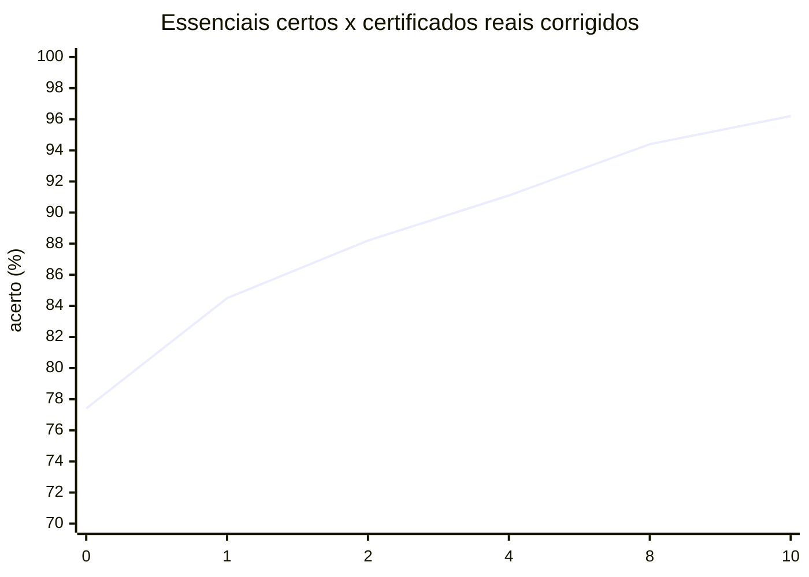

Nos laboratórios que aparecem pouco (um certificado de cada) a curva também sobe: balanças
**69,6 % → 82,6 %** e durômetro **76,9 % → 94,9 %** nos essenciais. Média dos 11 reais:
**76,6 % → 94,9 %**.

Os primeiros reais dão o maior salto; depois a curva continua subindo, mais devagar. Um exemplo do
que um único certificado ensina: o goniômetro em **graus e minutos** ("14°59'"), escondido do
treino, ia de **11 %** com os outros reais; depois que o modelo ganhou a pista "graus e minutos é
um número", foi para **100 %**.

📜 A prova na versão 0.8.0 (5 certificados reais)

A pergunta é simples: **quanto mais certificados reais corrigidos, mais ele acerta num certificado
que nunca viu?** Para responder sem trapaça, cada certificado real é **escondido** do treino e
usado só como prova; o modelo treina com 0, 1, 2, 3 e 4 dos outros reais e lê o escondido. Isso é
repetido para cada um dos 5 e tirada a média.

Quase todos os certificados do dia a dia vêm de um mesmo laboratório, por isso ele vem primeiro:

| Reais corrigidos no treino | **Essenciais certos** | **Padrões certos** | "Falsos" |
|---|---|---|---|
| nenhum (só fictícios) | 85,0 % | 87,4 % | 18 |
| 1 | 91,5 % | 93,8 % | 10 |
| 2 | 95,0 % | 97,9 % | 4 |
| 3 | 98,2 % | **100 %** | 3 |
| 4 | **100 %** | **100 %** | 3 |

Média de 3 certificados reais desse laboratório (2 digitais e 1 escaneado), cada um escondido do treino. Como são do mesmo laboratório, um ajuda o
outro — é exatamente o que acontece no uso. Só os números vão para o GitHub.

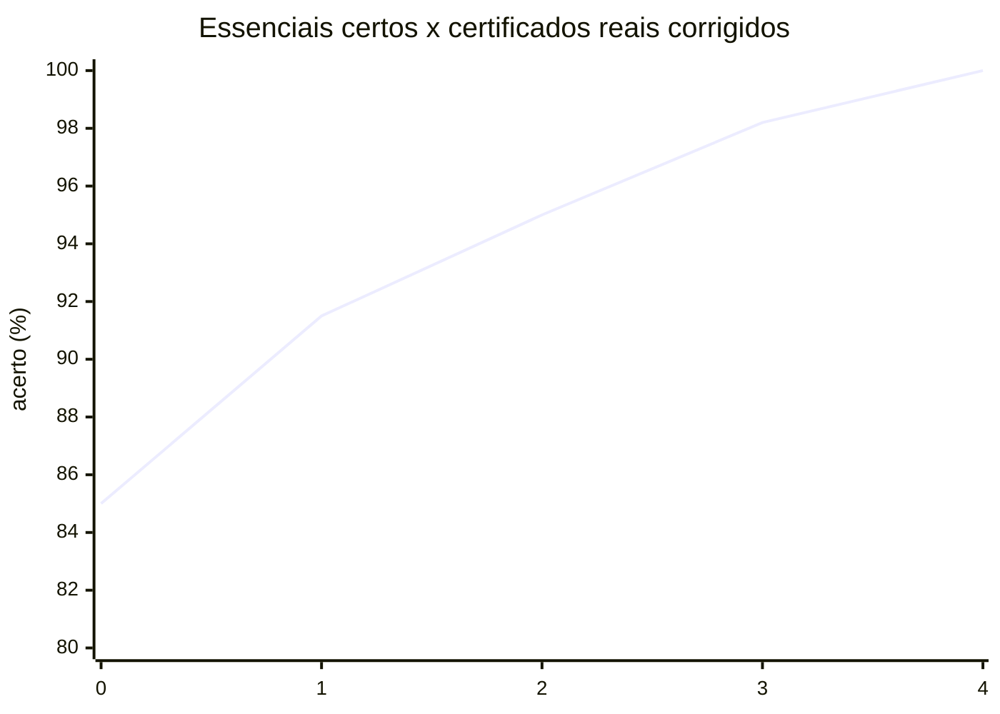

Nos laboratórios que aparecem pouco a curva também sobe, mais devagar: balanças **69,6 % →
87,0 %** e durômetro **76,9 % → 94,9 %** nos essenciais. Média dos 5 reais: **80,3 % → 96,4 %**.
Achar os padrões desses dois ainda é fraco (cada um tem um jeito próprio de escrever a tabela e só
há um certificado de cada) — por isso, quando não lê a validade, o programa avisa em amarelo e deixa
o parecer **PENDENTE**, em vez de aprovar sozinho.

> [!NOTE]
> Medir também achou um defeito na leitura: o carimbo "ESTE CERTIFICADO FOI ANALISADO" enganava a
> detecção de folha de cabeça para baixo. Depois de corrigir, esse escaneado foi de ~30 % para 96 %.

## 🛠️ Tecnologias

| Tecnologia | Aplicação no projeto |
|---|---|
| Python | Linguagem de todo o projeto. |
| scikit-learn | Modelo de machine learning (regressão logística): aprende o que cada palavra é. Gratuito, roda no computador. |
| reportlab | Escreve os PDFs digitais dos certificados fictícios. |
| pypdfium2 | Transforma o PDF em imagem (para o "escaneado") e lê o texto do PDF. |
| Pillow | Imita o scanner: giro, ruído, desfoque e compressão JPEG. |
| RapidOCR (ONNX) | OCR local e gratuito: lê os certificados escaneados, palavra por palavra, com a confiança de cada uma. |
| PySide6 (Qt) | Interface desktop: a folha com os checks, o parecer, a correção pela tela e o retreino com um clique. |
| pytest + ruff | Testes automáticos com certificados fictícios e padronização do código. |
| Git + GitHub | Uma branch e um pull request por etapa; decisões registradas em ADRs. |
| Claude Code | Desenvolvimento assistido por IA, com o autor definindo e aprovando cada etapa. |

Decisões de arquitetura: [`docs/decisoes/`](docs/decisoes/).

## 🗺️ Roteiro

- [x] Etapa 0 — Fundação (estrutura, versão, testes, decisões de arquitetura)
- [x] Etapa 1 — Gerador de certificados fictícios (5 laboratórios, digital e "escaneado") com gabarito anotado
- [x] Etapa 2 — Leitura do PDF: texto direto e OCR (palavras com posição e confiança)
- [x] Etapa 3 — Machine learning: encontrar os campos; acerto medido em treino × teste e em laboratório que o modelo nunca viu
- [x] Etapa 4 — Conferência com o plano: erro ± U dentro da tolerância (parecer só quando há certeza)
- [x] Aprendizado com o uso — o modelo aprende com certificados reais corrigidos (acerto nos essenciais: 70 % → 92 %; na 0.8.0, laboratório principal 85 % → 100 %)
- [x] Interface — abrir, ver os checks, corrigir e reaprender pela tela
- [x] Colunas "Erro Máximo" e "Critério de aceitação", comparador cadastro × certificado e Erro ± U igual ao do sistema de calibração (0.7.0)
- [x] Validade dos padrões — conferir que cada padrão usado estava válido no dia da calibração (0.8.0)
- [x] Conferência de conta e goniômetro — o número só vale se fecha a conta; graus e minutos lidos e mostrados como no certificado (0.9.0)
- [x] Registro de cada análise — quem, quando, o que foi lido e corrigido, com Lixeira; a correção só ensina depois de registrada (0.10.0)
- [x] Aprovação final pelo responsável, com carimbo digital e os checks no PDF (0.11.0)
- [ ] PDF com mais de uma folha — ler só as folhas necessárias
- [ ] Etapa 5 — Teste com certificados reais (só os números de acerto aparecem aqui)
- [ ] Previsão da deriva — prever quando cada instrumento sai da tolerância e sugerir a periodicidade de calibração

---

  <b>Projeto de estudo de machine learning aplicado à metrologia: aprender, medir o acerto e mostrar
  a evolução — com dados 100% fictícios.</b>

